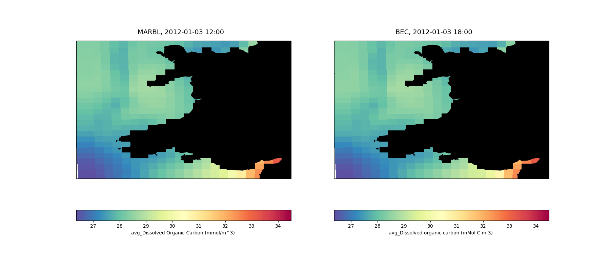

# roms_marbl_example
An example configuration of [ucla-roms](https://github.com/CESR-lab/ucla-roms) with a 24x24, 10km resolution domain of the Welsh coast.
BGC is handled by either [BEC]( https://doi.org/10.1029/2004GB002220) or [MARBL](https://doi.org/10.1029/2021MS002647) with BGC initial and boundary conditions taken from an existing run of CESM.

## Installation
You are viewing the `main` branch, which is designed to be accessed by the [C-Star python package](https://github.com/CWorthy-Ocean/C-Star), which is currently under development.

In the meantime, if you are interested in manually setting up the `roms_marbl_example` case, please see the [`no_cstar` branch](https://github.com/CWorthy-ocean/cstar_blueprint_roms_marbl_example/tree/no_cstar) for installation instructions.

## Namelists and ucla-roms versions

Each `*-domain-namelist*` directory holds a domain's run-time files (`namelist.nml`, `marbl_in`) and its compile-time `cppdefs.opt`. A namelist only works with the ucla-roms releases it was written for, so there is one directory per release line:

| Directory | ucla-roms |
|---|---|
| `wio-toy-domain-namelist`, `wales-toy-domain-namelist` | 0.2.0 and the commits after it that earlier C-Star releases pin |
| `wio-toy-domain-namelist-ucla-roms-0.13`, `wales-toy-domain-namelist-ucla-roms-0.13` | 0.13.0 |

The 0.13 namelists differ from the older ones in three ways:

- `nrpf_rst` is gone, and the particle output keys are `nrpf_particles` and `output_period_particles`.
- Every history file ends on a restart write, which ucla-roms 0.5.0 and later require: both domains now write one history file per day, and wio-toy writes a restart once a day instead of twice.
- `wales-toy-domain-namelist-ucla-roms-0.13/cppdefs.opt` turns on ParallelIO (the `pio` branch's `cppdefs.opt`). ucla-roms 0.13 builds it against CWorthy's ParallelIO fork (`https://github.com/CWorthy-ocean/ParallelIO.git`, tag `2.7.1-fork`).

wio-toy's original tidal forcing, `cson_roms-marbl_v0.1_wio-toy_10procs_tidal.nc`, was made with a model reference date of 2012-01-01, while its other inputs use 2000-01-01. `cson_roms-marbl_v0.1_wio-toy_10procs_tidal_ref2000.nc` has the same 15 TPXO constituents regenerated with ROMS-Tools 5.3.0 from TPXO10.v2a with reference date 2000-01-01; its ROMS-Tools YAML is in `wio-toy-domain/input_datasets_yaml/`. Use it with the 0.13 namelist: C-Star refuses inputs whose reference date differs from the namelist's.
